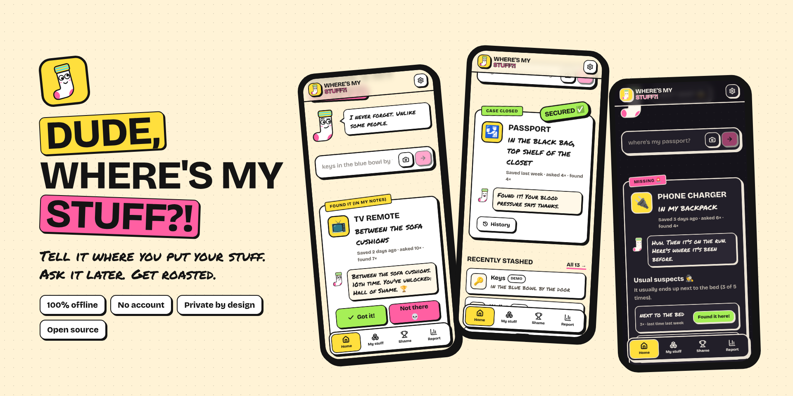
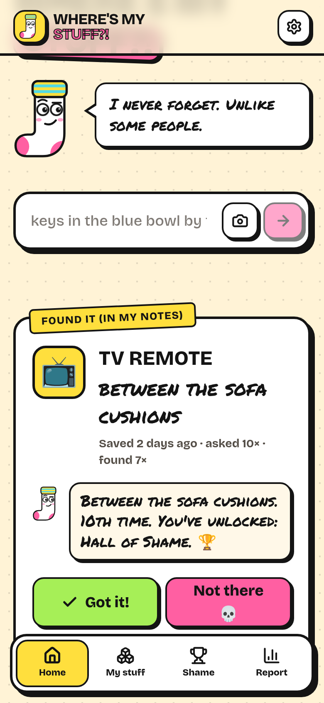
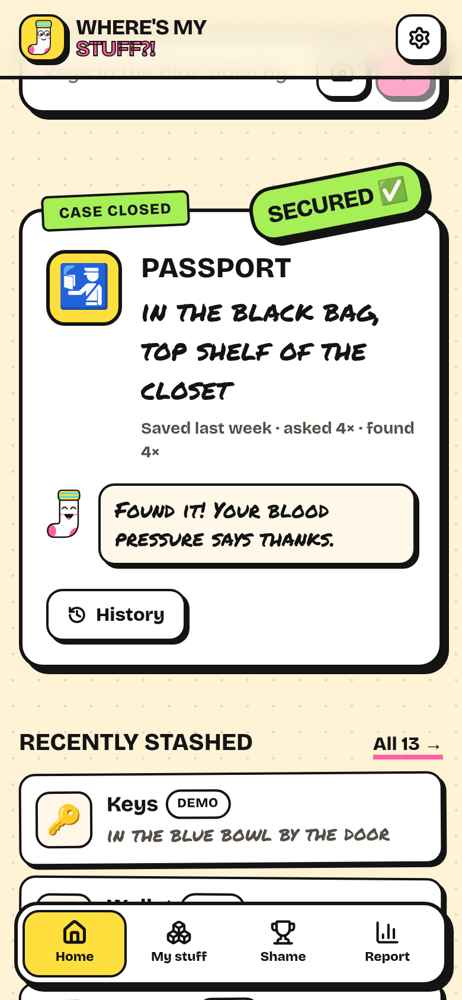
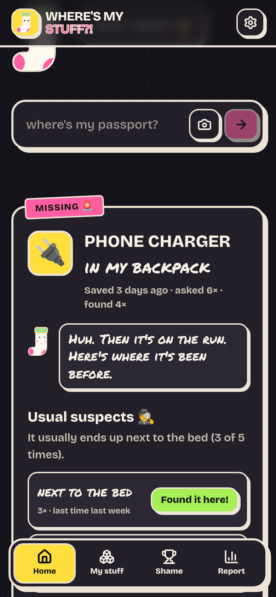
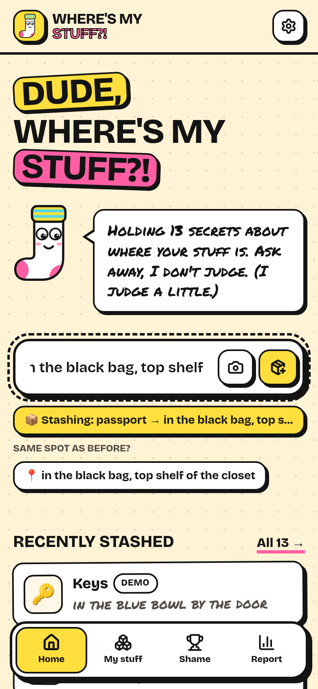
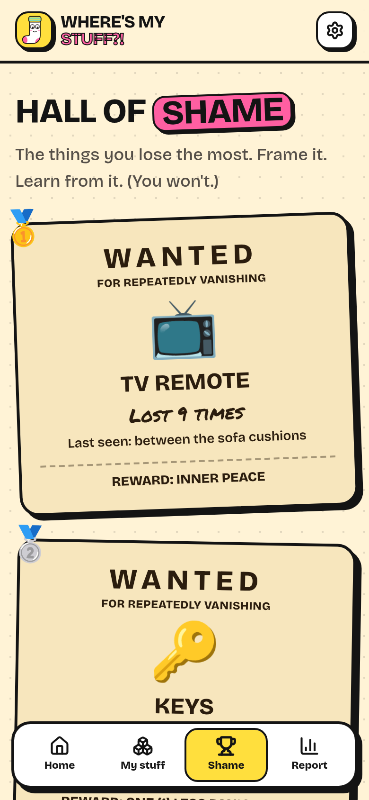
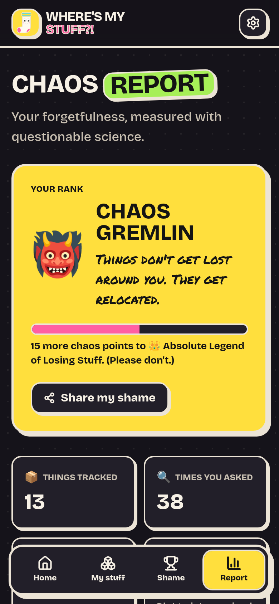
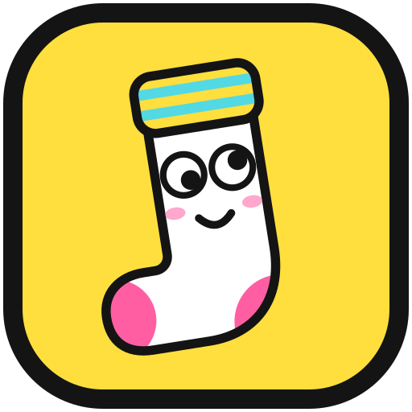

<div align="center">



# Dude, Where's My Stuff?

**Tell it where you put your stuff. Ask it later. Get roasted.**

A free, private, works-offline app that remembers where you put things,<br>
so your brain doesn't have to.

[**Open the app →**](https://muktaditbf.github.io/dude-wheres-my-stuff/)
&nbsp;·&nbsp; [Report a bug](https://github.com/Muktaditbf/dude-wheres-my-stuff/issues/new?template=bug_report.yml)
&nbsp;·&nbsp; [Submit a roast](https://github.com/Muktaditbf/dude-wheres-my-stuff/issues/new?template=roast.yml)

[](https://github.com/Muktaditbf/dude-wheres-my-stuff/actions/workflows/ci.yml)
[](LICENSE)
[](#privacy)
[](#privacy)

</div>

---

## The problem

You don't lose things. **You forget where you put them.** The passport is exactly where you left it.
Your brain just never saved the memory, because putting things down happens on autopilot.

- A [2017 survey by Pixie](https://iphonelife.com/content/lost-and-found-survey-shows-need-bluetooth-trackers) found people spend about **2.5 days a year** looking for misplaced things. TV remotes topped the list, then phones, keys and glasses. (They sell trackers, so take the number with a grain of salt. But you've been there.)
- Trackers only help with the few things you can stick a tag on. Your passport, the spare key, the HDMI cable and your birth certificate don't get one.

So here's a sock named Lefty who remembers for you.

## How it works

1. **Put something away and tell it:** `passport in the black bag, top shelf`
2. **Forget about it.** That's Lefty's job now.
3. **Ask later:** `where's my passport?` You get the answer. And a roast.

If it's not there, tap **Not there 💀**. Lefty shows every other place it has been, and where it _usually_ ends up
("It usually ends up next to the bed, 3 of 5 times"). That second chance is what actually finds your stuff.

<table>
  <tr>
    <td align="center"><br><sub><b>Ask</b> and get roasted</sub></td>
    <td align="center"><br><sub><b>Got it!</b> SECURED, with an air horn</sub></td>
    <td align="center"><br><sub><b>Not there?</b> The usual suspects</sub></td>
  </tr>
  <tr>
    <td align="center"><br><sub>Type like a human, see how it's understood</sub></td>
    <td align="center"><br><sub><b>Hall of Shame</b> wanted posters</sub></td>
    <td align="center"><br><sub><b>Chaos Report</b>: your rank</sub></td>
  </tr>
</table>

## Features

- 🗣️ **Talk like a human.** No forms. One box understands "keys in the blue bowl", "where's my passport?", "what's in the black bag?" and "lent my drill to Rafi". A live preview shows how it understood you before you press Enter.
- 🔍 **Forgiving search.** Typos (`wher are my glases`), synonyms (`specs` finds glasses, `clicker` finds the remote) and partial names (`remote` finds the TV remote). If it isn't sure, it asks "did you mean…" instead of guessing.
- 💀 **"Not there" mode.** Every move is remembered, so you get the earlier spots and the item's usual spot.
- 🤝 **Lent stuff.** "Rafi borrowed my drill" is remembered too, with an appropriately judgmental timer.
- 📸 **Evidence photos.** Snap where you put it. Photos are shrunk before saving.
- 🏆 **Hall of Shame** wanted posters, 👻 **Ghosted** items you haven't checked in months, and a 📊 **Chaos Report** with your forgetfulness rank (from _Suspiciously Organized_ to _Absolute Legend of Losing Stuff_).
- 😌😎🤪 **Roast levels:** _Chill_ (polite, facts only), _Bro_ (default) or _Unhinged_.
- 🎺 **Drama:** synthesized air horn and sad trombone (no audio files), confetti, screen shake and a plot-twist flash. Prefer calm? Turn it off; reduced-motion settings are respected too.
- 📴 **Installable and offline.** Add it to your home screen and it works with no connection at all.
- 🔒 **Private.** Everything stays on your device. [More below](#privacy).
- ♿ **Accessible.** Keyboard friendly (press `/` or `Ctrl+K` to jump to the input), screen-reader labels, and automated accessibility tests in light and dark mode.

## What you can type

| You type | Lefty understands |
| --- | --- |
| `keys in the blue bowl by the door` | 📦 **keys** → in the blue bowl by the door |
| `I put my passport in the black bag, top shelf` | 📦 **passport** → in the black bag, top shelf |
| `passport, wallet and keys in the safe` | 📦 three things → in the safe |
| `glasses are on top of my head` | 📦 **glasses** → on top of my head |
| `charger → kitchen drawer` | 📦 **charger** → kitchen drawer (arrows always work) |
| `lent my drill to Rafi` / `Rafi borrowed my drill` | 🤝 **drill** → with Rafi |
| `where's my passport?` / `wher are my glases` | 🔍 find it |
| `what's in the black bag?` | 🗄️ everything in that place |
| `found my keys in my jacket` | ✅ found it, and remember the new spot |

Stashing something you already have **moves** it (and keeps the history) instead of creating a duplicate.

## Make it faster than forgetting

The app only works if telling it is quicker than forgetting. Some shortcuts:

- **Install it:** browser menu → _Install app_ or _Add to Home Screen_. Long-press the icon for **Stash it** and **Find it** shortcuts.
- **Links that do things:**
  - `https://muktaditbf.github.io/dude-wheres-my-stuff/?add=keys%20in%20the%20drawer` saves instantly
  - `…/?q=keys` finds it
  - `…/?mode=stash` opens the app ready to type
- **iPhone:** make a Shortcut: _Dictate Text_ → _Open URL_ `…/?add=[Dictated Text]`. Now you can say "passport in the black bag" while putting it away.
- **Android:** the same with a home-screen bookmark, or Tasker.
- **Desktop:** bind a global hotkey to open `…/?mode=stash`.

## Privacy

- Your stuff lives **only in your browser** (IndexedDB) on your device.
- **No account, no server, no analytics, no cookies, no third-party requests.** Even the fonts are bundled.
- That also means clearing your browser data clears your stuff. Three ways to stay safe:
  - **Auto-backup** (Chrome and Edge on a computer): pick a file once, and every change is saved to that one file on your computer. If your browser data is wiped, open the app, choose **Restore backup** and pick the file.
  - **Download backup**: a JSON file you can restore anywhere, for example on a new phone.
  - **Protect my data**: asks the browser not to clear the data on its own.

## Built with

- **React 19**, **TypeScript** (strict) and **Vite 8**
- **Tailwind CSS v4**: a neo-brutalist "sticker" design with light and dark themes
- **Dexie** (IndexedDB) for local data, with undo for every change
- A hand-written, heavily tested **natural-language parser** (no AI, no network) plus **Fuse.js** for typo-tolerant search
- **motion** for animations and the **Web Audio API** for synthesized sound effects
- **vite-plugin-pwa** (Workbox) for offline support and installs; every icon is generated from one SVG
- **Vitest** unit tests, **Playwright** end-to-end tests on phone and desktop sizes (including offline mode and **axe** accessibility checks), **Biome** for linting and formatting
- **GitHub Actions** for CI, and **GitHub Pages** for hosting

```
src/
├── lib/parser.ts        # "keys in the drawer" → { stash: keys, place: in the drawer }
├── lib/normalize.ts     # "My Keys" and "the key" are the same thing
├── search/search.ts     # typos, synonyms, "did you mean"
├── db/                  # Dexie schema + every write (with undo)
├── lib/roasts.ts        # everything Lefty says ← PRs welcome!
├── lib/personality.ts   # picks the right roast for the moment
├── components/          # Lefty, result cards, stickers, sheets
└── pages/               # Home, My stuff, Hall of Shame, Chaos Report, Settings
```

## Run it locally

```bash
git clone https://github.com/Muktaditbf/dude-wheres-my-stuff.git
cd dude-wheres-my-stuff
npm install
npm run dev
```

| Command | What it does |
| --- | --- |
| `npm run dev` | Start the dev server |
| `npm test` | Unit tests (Vitest) |
| `npm run e2e` | End-to-end tests (Playwright; run `npx playwright install chromium` once) |
| `npm run check` | Lint, format check and type check |
| `npm run build` | Production build into `dist/` |
| `npm run screenshots` | Regenerate the README images (needs `npm run preview` running) |

The app is served from `/dude-wheres-my-stuff/` for GitHub Pages. To host it at the root of a domain, build with `BASE_PATH=/ npm run build`.

## Contributing

The easiest way to contribute is a **new roast**. Add a line to [`src/lib/roasts.ts`](src/lib/roasts.ts) or [suggest one in an issue](https://github.com/Muktaditbf/dude-wheres-my-stuff/issues/new?template=roast.yml). Parser improvements, new languages and bug fixes are very welcome too. See [CONTRIBUTING.md](CONTRIBUTING.md).

## Ideas for later

- Optional end-to-end encrypted sync between your phone and computer
- Understanding more languages than English
- A shared household list ("who moved the scissors?")
- QR stickers for boxes: scan a box, see what's inside
- Gentle reminders for lent stuff ("Rafi has had your drill for 45 days")

## License

[MIT](LICENSE) © Muktaditbf

<div align="center">
<br>
<br>
<sub>Made for everyone who has ever stood in a hallway holding nothing, wondering where everything went.</sub>
</div>
